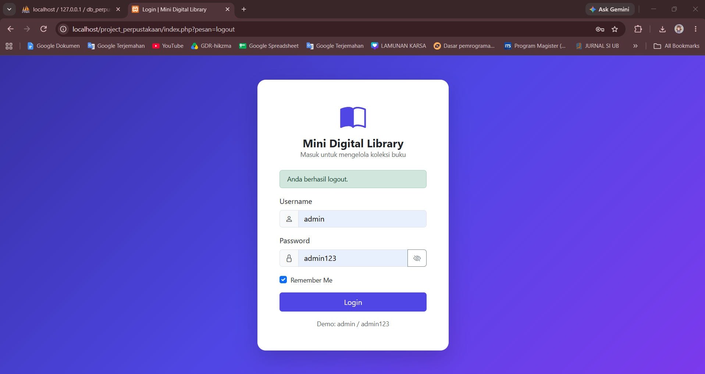
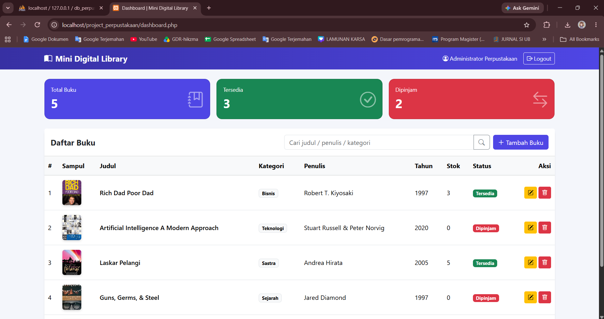
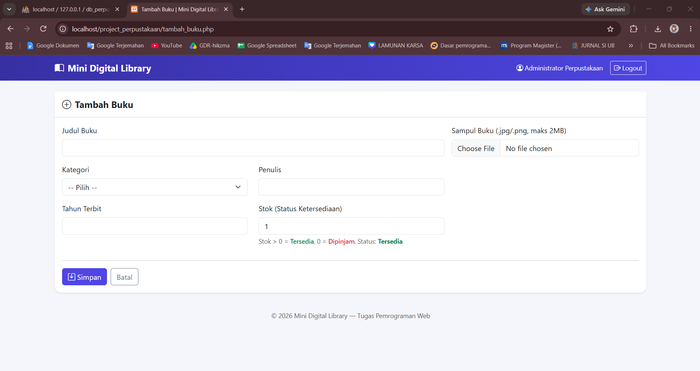
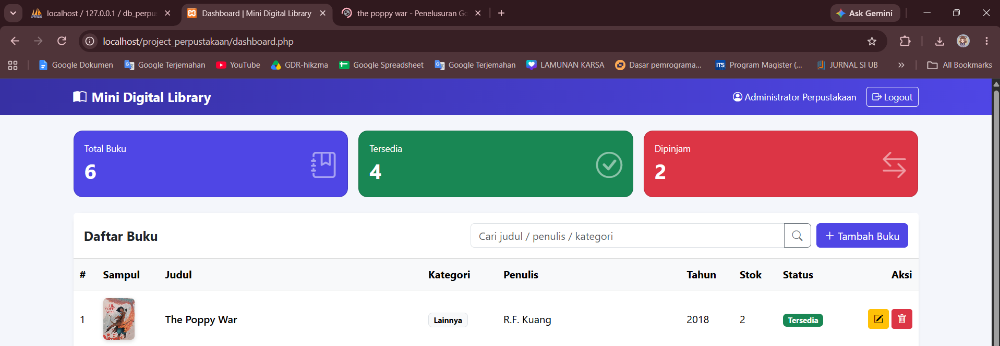
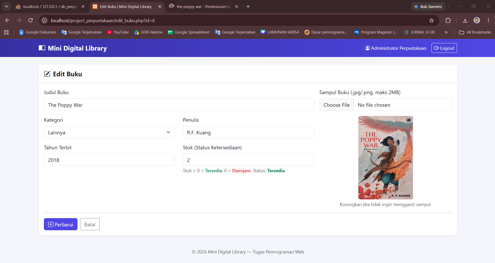
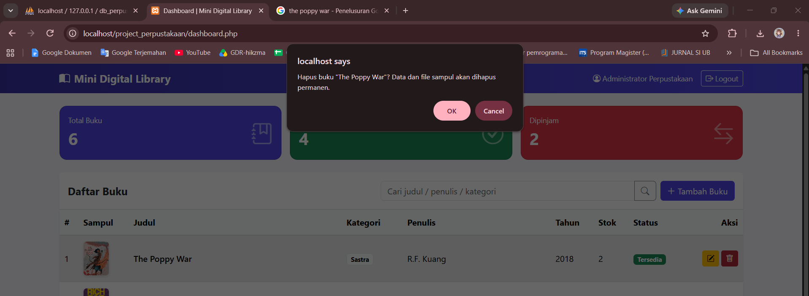

# Mini Digital Library

Aplikasi manajemen perpustakaan mini berbasis PHP Native, MySQL, dan Bootstrap 5 yang dikembangkan untuk memenuhi tugas mata kuliah **Pemrograman Web** – Program Studi Sistem Informasi.

---

## Identitas

- **Nama**: Hikma Nazwa Agustin
- **NIM**: 2513020076

---

## Fitur Utama

- **Autentikasi Aman**: Login POST, manajemen Session, fitur "Remember Me" (Cookie username 30 hari), dan Logout aman (menghapus session & cookie).
- **CRUD Data Buku**: Pengelolaan data buku meliputi judul, kategori, penulis, tahun terbit, stok, serta status ketersediaan.
- **Upload Sampul Buku**: Menerima format `.jpg` dan `.png` (maksimal 2 MB) dengan validasi ketat (ekstensi, MIME type, serta cek isi gambar). File disimpan di folder `uploads/` dan nama filenya disimpan pada database.
- **Penanganan Penghapusan (Delete)**: Menghapus data pada database MySQL sekaligus menghapus berkas gambar terkait dari server (`unlink`).
- **Logika Bisnis**: Stok > 0 bertanda "Tersedia", sedangkan Stok = 0 otomatis bertanda "Dipinjam" (logika conditional `if-else`). Kategori dikelola menggunakan struktur array.
- **Keamanan (Security)**:
  - Prepared Statements (`mysqli`) untuk mencegah SQL Injection.
  - `password_hash()` & `password_verify()` untuk keamanan kata sandi.
  - `session_regenerate_id()` untuk mencegah Session Fixation.
  - Token CSRF pada aksi Create, Update, dan Delete.
  - Escaping output (`htmlspecialchars`) untuk mengantisipasi serangan XSS.
- **Antarmuka (UI/UX)**: Bootstrap 5 (CDN) dipadu dengan `css/style.css` dan `js/style.js` (fitur toggle password, live preview gambar, dialog konfirmasi hapus, dan validasi di sisi klien).

---

## Struktur Folder

```text
project_perpustakaan/
├── config/
│   └── koneksi.php
├── includes/
│   ├── auth.php
│   ├── header.php
│   ├── footer.php
│   └── form_buku.php
├── css/
│   └── style.css
├── js/
│   └── style.js
├── uploads/
├── screenshot/
│   ├── 1login.png
│   ├── 2tampilan.png
│   ├── 3tambah1.png
│   ├── 3tambah2.png
│   ├── 4tampilantambah.png
│   ├── 5edit.png
│   ├── 5edit2.png
│   └── 6hapus.png
├── database.sql
├── index.php
├── proses_login.php
├── logout.php
├── dashboard.php
├── tambah_buku.php
├── proses_tambah.php
├── edit_buku.php
├── proses_edit.php
└── hapus_buku.php
```

---

## Dokumentasi Database (`db_perpustakaan`)

Seluruh skema database tersedia pada berkas `database.sql`. Berkas ini membuat database, tabel, dan akun admin default sekaligus.

### Informasi Umum

| Item           | Nilai                |
| -------------- | -------------------- |
| Nama Database  | `db_perpustakaan`    |
| DBMS           | MySQL / MariaDB      |
| Storage Engine | InnoDB               |
| Character Set  | `utf8mb4`            |
| Collation      | `utf8mb4_unicode_ci` |
| Jumlah Tabel   | 2 (`users`, `buku`)  |

### Cara Import

**Opsi 1 – phpMyAdmin**

1. Jalankan Apache dan MySQL pada XAMPP/Laragon.
2. Buka `http://localhost/phpmyadmin`.
3. Pilih tab **Import**, lalu pilih berkas `database.sql`.
4. Klik **Go / Kirim**.

**Opsi 2 – Command Line**

```bash
mysql -u root -p < database.sql
```

### Konfigurasi Koneksi

Pengaturan koneksi berada pada `config/koneksi.php`. Sesuaikan jika kredensial MySQL berbeda.

```php
$host = "localhost";
$user = "root";
$pass = "";
$db   = "db_perpustakaan";
```

Koneksi menggunakan ekstensi `mysqli` dengan `set_charset("utf8mb4")` dan mode pelaporan error `MYSQLI_REPORT_ERROR | MYSQLI_REPORT_STRICT`.

### Struktur Tabel

#### Tabel `users`

Menyimpan data akun yang berhak masuk ke aplikasi.

| Kolom          | Tipe Data      | Constraint                  | Keterangan                                  |
| -------------- | -------------- | --------------------------- | ------------------------------------------- |
| `id`           | `INT`          | PRIMARY KEY, AUTO_INCREMENT | ID unik pengguna                            |
| `username`     | `VARCHAR(50)`  | NOT NULL, UNIQUE            | Nama pengguna untuk login                   |
| `password`     | `VARCHAR(255)` | NOT NULL                    | Hash kata sandi (bcrypt, `password_hash()`) |
| `nama_lengkap` | `VARCHAR(100)` | NOT NULL                    | Nama lengkap pengguna                       |

```sql
CREATE TABLE IF NOT EXISTS users (
  id INT AUTO_INCREMENT PRIMARY KEY,
  username VARCHAR(50) NOT NULL UNIQUE,
  password VARCHAR(255) NOT NULL,
  nama_lengkap VARCHAR(100) NOT NULL
) ENGINE=InnoDB;
```

#### Tabel `buku`

Menyimpan data koleksi buku perpustakaan.

| Kolom          | Tipe Data      | Constraint                  | Keterangan                                                                     |
| -------------- | -------------- | --------------------------- | ------------------------------------------------------------------------------ |
| `id`           | `INT`          | PRIMARY KEY, AUTO_INCREMENT | ID unik buku                                                                   |
| `judul`        | `VARCHAR(200)` | NOT NULL                    | Judul buku                                                                     |
| `kategori`     | `VARCHAR(50)`  | NOT NULL                    | Kategori buku (Teknologi, Sains, Sastra, Sejarah, Bisnis, Pendidikan, Lainnya) |
| `penulis`      | `VARCHAR(100)` | NOT NULL                    | Nama penulis                                                                   |
| `tahun_terbit` | `YEAR`         | NOT NULL                    | Tahun terbit buku                                                              |
| `stok`         | `INT`          | NOT NULL, DEFAULT `0`       | Jumlah stok; menentukan status ketersediaan                                    |
| `sampul`       | `VARCHAR(255)` | DEFAULT `NULL`              | Nama berkas gambar sampul di folder `uploads/`                                 |
| `created_at`   | `TIMESTAMP`    | DEFAULT `CURRENT_TIMESTAMP` | Waktu data ditambahkan                                                         |

```sql
CREATE TABLE IF NOT EXISTS buku (
  id INT AUTO_INCREMENT PRIMARY KEY,
  judul VARCHAR(200) NOT NULL,
  kategori VARCHAR(50) NOT NULL,
  penulis VARCHAR(100) NOT NULL,
  tahun_terbit YEAR NOT NULL,
  stok INT NOT NULL DEFAULT 0,
  sampul VARCHAR(255) DEFAULT NULL,
  created_at TIMESTAMP DEFAULT CURRENT_TIMESTAMP
) ENGINE=InnoDB;
```

### Relasi Antar Tabel

Tabel `users` dan `buku` **tidak memiliki relasi (foreign key)**. Keduanya berdiri sendiri: `users` dipakai untuk autentikasi, sedangkan `buku` untuk data koleksi.

```text
┌──────────────────┐        ┌──────────────────────┐
│      users       │        │         buku         │
├──────────────────┤        ├──────────────────────┤
│ PK id            │        │ PK id                │
│    username (UQ) │        │    judul             │
│    password      │        │    kategori          │
│    nama_lengkap  │        │    penulis           │
└──────────────────┘        │    tahun_terbit      │
                            │    stok              │
                            │    sampul            │
                            │    created_at        │
                            └──────────────────────┘
```

### Data Awal (Seed)

Saat di-import, tabel `users` otomatis terisi satu akun administrator. Kata sandi disimpan dalam bentuk hash bcrypt, bukan teks asli.

| Kolom          | Nilai                        |
| -------------- | ---------------------------- |
| `username`     | `admin`                      |
| `password`     | hash bcrypt dari `admin123`  |
| `nama_lengkap` | `Administrator Perpustakaan` |

### Query yang Digunakan Aplikasi

Seluruh query yang menerima input pengguna menggunakan **prepared statements**.

| Berkas              | Operasi | Query                                                                                                     |
| ------------------- | ------- | --------------------------------------------------------------------------------------------------------- |
| `proses_login.php`  | SELECT  | `SELECT id, username, password, nama_lengkap FROM users WHERE username = ? LIMIT 1`                       |
| `dashboard.php`     | SELECT  | `SELECT * FROM buku ORDER BY id DESC`                                                                     |
| `dashboard.php`     | SELECT  | `SELECT * FROM buku WHERE judul LIKE ? OR penulis LIKE ? OR kategori LIKE ? ORDER BY id DESC` (pencarian) |
| `dashboard.php`     | SELECT  | `SELECT COUNT(*) c FROM buku` (total buku)                                                                |
| `dashboard.php`     | SELECT  | `SELECT COUNT(*) c FROM buku WHERE stok > 0` (buku tersedia)                                              |
| `edit_buku.php`     | SELECT  | `SELECT * FROM buku WHERE id = ?`                                                                         |
| `proses_tambah.php` | INSERT  | `INSERT INTO buku (judul, kategori, penulis, tahun_terbit, stok, sampul) VALUES (?, ?, ?, ?, ?, ?)`       |
| `proses_edit.php`   | SELECT  | `SELECT sampul FROM buku WHERE id = ?`                                                                    |
| `proses_edit.php`   | UPDATE  | `UPDATE buku SET judul=?, kategori=?, penulis=?, tahun_terbit=?, stok=?[, sampul=?] WHERE id=?`           |
| `hapus_buku.php`    | SELECT  | `SELECT sampul FROM buku WHERE id = ?`                                                                    |
| `hapus_buku.php`    | DELETE  | `DELETE FROM buku WHERE id = ?`                                                                           |

### Aturan Data & Logika Bisnis

- **Status ketersediaan** tidak disimpan di database, melainkan dihitung dari kolom `stok`: `stok > 0` → **Tersedia**, `stok = 0` → **Dipinjam**.
- **Kategori** divalidasi di sisi aplikasi terhadap array `daftar_kategori()` (kolom `kategori` berupa `VARCHAR`, bukan `ENUM`).
- **Tahun terbit** harus berada di rentang 1900 hingga tahun berjalan + 1.
- **Stok** harus berupa bilangan bulat >= 0.
- **Sampul**: kolom `sampul` hanya menyimpan nama berkas (contoh: `sampul_1a2b3c4d5e6f7a8b.jpg`), sedangkan berkas fisik berada di folder `uploads/`. Saat data buku dihapus atau sampul diganti, berkas lama ikut dihapus dari server.

### Contoh Query Manual

```sql
-- Menambahkan buku
INSERT INTO buku (judul, kategori, penulis, tahun_terbit, stok)
VALUES ('Pemrograman Web dengan PHP', 'Teknologi', 'Nama Penulis', 2023, 5);

-- Menampilkan buku beserta status ketersediaan
SELECT id, judul, stok,
       IF(stok > 0, 'Tersedia', 'Dipinjam') AS status
FROM buku
ORDER BY id DESC;

-- Rekap jumlah buku per kategori
SELECT kategori, COUNT(*) AS jumlah_judul, SUM(stok) AS total_stok
FROM buku
GROUP BY kategori;

-- Membuat akun admin baru (hash dibuat dengan password_hash() di PHP)
INSERT INTO users (username, password, nama_lengkap)
VALUES ('petugas', '<hash_bcrypt>', 'Petugas Perpustakaan');
```

> Untuk membuat hash kata sandi, jalankan: `php -r "echo password_hash('katasandi', PASSWORD_DEFAULT);"`

---

## Akun Demo

| Username | Password   |
| -------- | ---------- |
| `admin`  | `admin123` |

---

## Lampiran Mini Digital Perpustakaan

Berikut adalah tampilan antarmuka dari aplikasi Mini Digital Perpustakaan:

### 1. Halaman Login


_Keterangan: Halaman awal autentikasi pengguna. Dilengkapi dengan form masukan username, password (dengan toggle perlihatkan password), serta opsi "Remember Me"._

### 2. Dashboard / Daftar Buku


_Keterangan: Halaman utama setelah berhasil login. Menampilkan tabel daftar koleksi buku, pencarian, status ketersediaan (Tersedia/Dipinjam), serta tombol aksi untuk Tambah, Edit, dan Hapus._

### 3. Form Tambah Buku




_Keterangan: Formulir input untuk menambahkan data buku baru ke perpustakaan beserta upload gambar sampul dan pratinjau (preview) gambar._

### 4. Form Edit Buku



_Keterangan: Halaman pengubahan data buku yang sudah ada, termasuk opsi pembaruan sampul buku._

### 5. Konfirmasi Hapus Data


_Keterangan: Dialog konfirmasi keamanan saat menghapus data buku untuk mencegah aksi tidak disengaja._

---

## Catatan Penggunaan

1. **Import Database**: Import `database.sql` terlebih dahulu sebelum menjalankan aplikasi (lihat bagian _Dokumentasi Database_).
2. **Koneksi Internet**: Diperlukan untuk memuat library pustaka Bootstrap 5 via CDN.
3. **Cookie Security**: Fitur "Remember Me" hanya menyimpan data username dalam cookie dan tidak pernah menyimpan password.
4. **Konfigurasi PHP**: Pastikan konfigurasi `upload_max_filesize` dan `post_max_size` pada `php.ini` bernilai minimal **2M**.

---

## Link Demonstrasi Video

- **YouTube**: [Lihat Video Demo Aplikasi](https://youtu.be/BGXWxFxnXnE?si=RBoBsQk9L09BcgY_)
